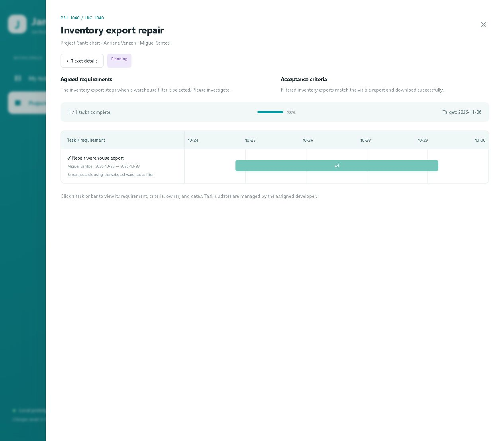

# JarcTech Ticket

A working local prototype for JARC Technologies ticket intake, admin assignment, developer planning, and shared project Gantt tracking.

## Start here

1. Extract this ZIP. Open the folder containing this README and `package.json`.
2. Install Node.js 22 or newer if needed.
3. Open a terminal in this folder and run:

```powershell
npm start
```

Open **http://localhost:4175**. The browser prototype itself needs no packages. Run `npm.cmd install` once before the checks and tests, which use the MongoDB driver and a temporary test database.
If PowerShell blocks `npm.ps1`, use `npm.cmd start`.
If another app already uses that port:

```powershell
$env:PORT = '4176'
npm.cmd start
```

Use the URL printed in your terminal. Stop the server with Ctrl+C.

## What is included

- JARC teal styling and the project name **JarcTech Ticket**.
- Only ticket and project navigation; no Meetings or Change requests sidebar tabs.
- Request types: every request is a **Ticket** (simple work) or a **Project** (mandatory requirements meeting, a locked agreement, and a timeline), chosen on the form and separate from the request category.
- Admin: Tickets received shows every request, with an **Admin overview** of Tickets and Projects by stage (new, active, awaiting worker completion, awaiting Requestor confirmation, ready for closure, closed, overdue) that drills through to the records. Admins review, request information, assign (to a Developer or themselves), reject, hold, and close.
- Requestor: My ticket, the request form, progress monitoring, meeting and agreement confirmation, evidence review, completion confirmation or correction, and comments.
- Developer: Assigned work shows the work assigned to them (and their own requests): meetings, agreements, timelines, tasks, evidence, and their completion confirmation.
- Two-step project timeline from the locked agreement: project name and delivery target, then dated tasks.
- Completion proof and two confirmations: the worker adds evidence (files or links) and marks the work done; the Requestor confirms independently; only then can an Admin close it.
- Projects list opens a Gantt chart with task dates, owner, requirement, task criteria, and completion.
- Linked scope changes remain inside each ticket and retain assessment, agreement, approval, testing, acceptance, release, and closure.
- Browser-local persistence, sample data, syntax checks, date tests, static server tests, backend foundation tests, and a GitHub Actions check.

The header's **Demo role** selector replaces the old three-button preview strip. It is a preview aid, not sign-in or access control. Requestor demo identity: Adriane Venzon. Developer demo identity: Miguel Santos. Admin demo identity: Alex Admin (used when the Admin assigns work to themselves).

## Continue with Claude Code and GitHub

Read [the Windows setup guide](docs/GETTING-STARTED.md), then [the phased build plan](docs/BUILD-PLAN.md). Claude Code reads the repository's [CLAUDE.md](CLAUDE.md) for context. The chosen architecture (GitHub, Railway, MongoDB) is recorded in [docs/ARCHITECTURE.md](docs/ARCHITECTURE.md), and the backend plan is in [docs/BACKEND-PLAN.md](docs/BACKEND-PLAN.md). The app itself is still the browser-only prototype until that plan is implemented.

**Extract the ZIP before adding code to GitHub. Upload or commit its contents, not the ZIP itself.** The repository root should contain `package.json`, `server.cjs`, `CLAUDE.md`, `public/`, and `docs/`.

## Backend foundation (not used by the UI yet)

The server can connect to MongoDB and report its health, but **the UI still stores records only in the browser**. No ticket API exists yet, and nothing is read from or written to the database except a connection check (`ping`).

- **Without database settings:** `npm start` runs exactly as the browser-only prototype.
- **With database settings:** set `MONGODB_URI` and `MONGODB_DB_NAME` in a local `.env` (copy [`.env.example`](.env.example)) or as Railway variables, and the server checks the connection at start-up. Point local development at a development database, never production.
- **Endpoints:**
  - `GET /healthz` returns `200 {"status":"ok"}` while the process is running.
  - `GET /readyz` returns `200 {"status":"ready","database":"connected"}` when MongoDB answers. Otherwise it returns `503` with `database` set to `not-configured`, `unreachable`, or `stopping`.
  - Neither endpoint ever includes error details. Those go to the server log with credentials redacted.
- **Settings are validated at start-up.** Every problem is listed by variable name, and values are never shown. In production or on Railway the database settings are required, and the server binds to `0.0.0.0` on Railway's `PORT`.
- **Shutdown:** on `SIGTERM` or Ctrl+C the server stops accepting connections, lets in-flight requests finish (up to 8 seconds), closes the database connection, and exits.
- **`.env` precedence:** settings already in the environment win over `.env`. Tests and the browser walkthrough never read `.env`; they set `NODE_ENV=test` or `JARCTECH_ENV_FILE=none`.
- **Railway:** `railway.json` sets the start command and uses `/readyz` as the deploy health check. Nothing has been deployed.

## Microsoft Entra sign-in (implemented; not yet configured with real credentials)

There are two modes, chosen with `AUTH_MODE`:

| Mode | Use | Behavior |
| --- | --- | --- |
| `demo` (or unset locally) | Local only | The browser-only prototype with the Demo role selector, exactly as before. Refused when deployed. |
| `entra` | Required when deployed; optional locally | Microsoft sign-in is required for the whole app. Needs MongoDB and all of the Entra settings below. |

**Safety rules:**
- The server refuses to start if `AUTH_MODE=entra` is missing any setting, if Entra settings are present without `AUTH_MODE`, or if a deployed server would run in demo mode.
- If sign-in fails at runtime (Microsoft is unreachable, or a response is invalid), the user sees an error page. **It never falls back to demo mode.**

**Who can get in: the access policy (`ACCESS_POLICY`)**

| Policy | Who can sign in | New accounts |
| --- | --- | --- |
| `invite-only` (default when unset) | Only people a JarcTech Admin invited by email, plus the first Admin created with the bootstrap command | Created only by an Admin invitation, with the role the Admin chose |
| `tenant-members` (**current beta policy**) | Every **member** account of the configured JARC GROUP tenant (`ENTRA_TENANT_ID`). No Entra assignment and no app invitation are needed. | Created automatically on first sign-in, **always as Requestor** |

**Rules in both policies:**
- **Refused:** guests (B2B accounts from other organizations), personal Microsoft accounts, accounts from any other tenant, and disabled users all get an "Access not granted" page, and no account is created. Admins can see refused attempts in the sign-in log.
- **Roles never come from Microsoft.** Admin and Developer are given only by a JarcTech Admin on the Users screen, by an invitation that names that role, or by the owner's one-time `admin:bootstrap`. Role, group, and directory-role claims are ignored, as is anything sent by the browser.
- **Existing records win.** An invitation keeps its role on first sign-in. Roles an Admin set are kept on later sign-ins and never reset to Requestor. A disabled or revoked person stays locked out: beta access never creates a replacement account for a disabled email.
- **One account per Microsoft account.** The account is permanently linked to the person's Entra object ID. If an email is already linked to a different Microsoft account, sign-in is refused for an Admin to resolve.
- **Restoring invite-only:** remove `ACCESS_POLICY` (or set it to `invite-only`) and restart. Auto-admitted Requestors keep their accounts; an Admin can disable any of them on the Users screen.

For the beta, the app registration's enterprise application must have **Assignment required = No**. Otherwise Entra itself blocks members who are not individually assigned.

**Roles:**
- `Requestor`, `Admin` and `Developer` are stored on the server and read on every request.
- Any role in the browser (query string, header, cookie, or devtools) is ignored by the server.
- In signed-in mode the Demo role selector is hidden. The header shows the signed-in name, role, and **Sign out**; Admins also get a **Users** button for invitations, role changes, and disabling access.
- Nobody can change their own role or access, and the last active Admin cannot be removed.

**Sessions:**
- Stored server-side in MongoDB. Only a hash of each session token is stored.
- They end after 8 hours idle or 24 hours in total, on sign-out, or immediately when a user is disabled.
- The cookie is `HttpOnly` and `SameSite=Lax`, and also `Secure` on https.
- Changes are only accepted from the app's own address (`APP_BASE_URL`).

> **Status: a beta, not yet a production system.**
>
> **Protected by the server:**
> - who can open the app (Microsoft sign-in plus admission policy)
> - app roles, sessions, and user management (Admins only)
> - **My workspace tickets**: ownership, assignment, and every read and write (see below)
>
> **Not yet production-ready:** no security review or penetration test has been done; attachments are not malware-scanned; audit history covers sign-in, user changes, and beta resets, with ticket activity kept on each ticket.
>
> Records created before My workspace existed in a signed-in browser (in `localStorage`) are left untouched in that browser and are not imported.

### My workspace: real roles and ticket ownership

With sign-in on, **My workspace** is the main view. Its tickets, projects, comments, attachments, and notifications are stored on the server (`tickets`, `ticket_changes`, `attachments`, `files.*`, `notifications`). Access comes only from the signed-in account, read from the database on every request:

| App role | Can see and act on |
| --- | --- |
| **Requestor** (default for every newly admitted member) | Their own requests and everything that belongs to them: submit, track, comment, confirm meetings and agreements, review the evidence, and confirm completion or return it for correction |
| **Developer** | Work assigned to them, plus their own requests: meetings, agreements, timelines, tasks, evidence, and the worker's completion confirmation. **No assignment authority and no user management.** |
| **Admin** | Every request: review, request information, assign to an active Developer or **themselves**, reject, hold, approve scope changes, and final closure; plus **exclusive** user and role management. An Admin who assigns work to themselves is its worker. |

- **The server derives everything:** ownership comes from the session, never from the browser, and so do the roles and view. Another person's records answer *not found* in every route: lists, search, direct ticket URLs, actions, linked changes, attachment downloads, the activity feed, and notifications.
- **Capacities:** an Admin acts as Admin on every request; the assigned worker (a Developer, or a self-assigned Admin) does the delivery work; the owner of a request acts as its Requestor.
- **Assignment:** an Admin chooses an active Developer or themselves, never sample people. Delivery reminders go to the worker; escalations go to the shared Admin inbox. Work assigned to someone who later becomes a Requestor or is disabled stays visible to Admins for reassignment, and the former worker loses access at once.
- **Independent confirmations:** the worker's and the Requestor's completion confirmations are recorded separately with who, which capacity, and when. One account never confirms both sides: when the Requestor is also the worker, a different Admin reviews for the Requestor side.
- **Role and access changes:** an Admin changes roles and access on the **Users** screen. The server refuses every user-management request from anyone else, including Developers and simulated views.
  - They apply at once. Disabling an account ends its sessions, and an open page reloads with the new role when the person returns to it.
  - Nobody can change their own role or access, and the last active Admin can never be demoted or disabled, even when two Admins change each other at the same moment.
- **Numbering:** My workspace tickets are numbered from `JRC-2001` (changes from `CR-501`), apart from the beta simulation's numbers.
- **Simulation is separate:** the header's **Workspace** switch chooses **My workspace** or **Beta simulation** (when enabled). Simulated views and sample people never grant anything in My workspace, and beta records are never converted into real tickets.

### Request types, agreements, and the completion gate

| Step | Ticket | Project |
| --- | --- | --- |
| 1. Submit (Requestor) | Request type **Ticket** | Request type **Project** |
| 2. Review and assign (Admin) | Request information if needed; assign to an active Developer or themselves. The Admin can change the type until planning is agreed. | Same |
| 3. Plan | Optional meeting | **Mandatory** requirements meeting, confirmed by the Requestor. The worker records the meeting notes, agreed requirements, and acceptance criteria; the worker and the Requestor confirm separately; then the agreement **locks**. The timeline (tasks, owners, dates, delivery target) is created from it. |
| 4. Work and evidence (worker) | Start work; add evidence | Start development; update tasks; add evidence |
| 5. Worker marks done | Needs at least one evidence file or link and a delivery and testing summary | Also needs every task done and the locked agreement |
| 6. Requestor confirms | Reviews the evidence; confirms or returns it for correction | Same |
| 7. Release or handover (worker) | Optional | Required |
| 8. Close (Admin only) | After both confirmations | After both confirmations and the handover |

- **Locked agreements:** after locking, nobody edits the requirements, criteria, or delivery target directly (the server refuses it). New or changed requirements go through the linked scope change: Admin review, worker impact assessment, Requestor agreement, Admin approval. Approval adds **a new agreement version**; earlier versions are kept and shown.
- **Scheduling:** task progress stays available; task dates can move within the delivery target, and every change is recorded in the activity with its old and new dates. Only an approved scope change moves the delivery target, with a note of the old and new target.
- **Stale confirmations never close changed work:** returning for correction, the worker withdrawing their completion, reassignment while awaiting confirmation, or an approved scope change clears earlier confirmations. Cleared confirmations and correction reasons stay on the record.
- **Evidence:** files reuse the attachment storage and permissions (only the uploader's own uploads can become evidence; downloads follow ticket access and are always served as attachments). Links must be plain `http` or `https` addresses without credentials; they are shown as links that open in a new tab and are never fetched by the server.
- **Older records:** `npm run db:migrate-request-types` classifies existing requests (linked project: Project; otherwise Ticket). Projects created before locked agreements and requests completed before dual confirmation are not given invented confirmations: details list the missing steps, and the worker and Requestor can still record them.

### Due dates, reminders, and escalation

- **Two dates:** the **requested target date** is the requestor's, set on the form. The **agreed delivery date** is the target the worker sets when creating a Project's timeline from the locked agreement, and it changes only through an approved scope change. Lists and details show both, with **Overdue** and **Due soon** labels and a summary of overdue, due-soon, and awaiting-decision tickets that doubles as a filter.
- **Timezone:** dates are calendar days in `WORKSPACE_TIMEZONE` (default **Asia/Manila**).
- **Reminders** are in-app notifications (the bell), created on the server. They never depend on a browser being open. Default thresholds, all whole days:

| Situation | Who | When (default) | Variable |
| --- | --- | --- | --- |
| Delivery due soon | Assigned worker | 2 days before the agreed date | `REMINDER_DUE_SOON_DAYS` |
| Delivery overdue | Assigned worker | The day after the agreed date | |
| Overdue escalation | Admins | 2 days overdue | `REMINDER_ESCALATE_OVERDUE_DAYS` |
| Completed work awaiting the Requestor's confirmation | Requestor | After 2 days | `REMINDER_ACCEPTANCE_DAYS` |
| Confirmation escalation | Admins | After 5 days | `REMINDER_ESCALATE_ACCEPTANCE_DAYS` |
| Request awaiting review, information requested, meeting or agreement awaiting confirmation, release or handover pending, both confirmations recorded (closure), scope change awaiting agreement or approval | Whoever must act | After 2 days | `REMINDER_PENDING_DAYS` |

- **Each reminder is sent once.** Its key is the record, the reminder, and the deadline or state it is about, so repeated runs, restarts, and several instances never duplicate it.
  - A changed agreed date is a new deadline, so it gets its own reminders.
  - Completed, released, cancelled, rejected, and on-hold work gets none.
- **Scheduling:** every `REMINDER_INTERVAL_MINUTES` (default 5), one running instance holds a lease in `scheduler_locks` and scans current records.
  - **Recovery:** if that instance stops, the lease expires (after about two intervals) and another takes over. After a restart, missed reminders are caught up on the next run.
  - **Turning it off:** set `REMINDERS=disabled`.
- **Simulation:** reminders for beta simulation records go only to the simulated inboxes and are never emailed.

### Optional email (off by default)

Email uses [Resend](https://resend.com)'s HTTPS API. It needs no Microsoft Entra, Graph, tenant, or consent changes, and no package.
- **How to turn it on:** set `EMAIL_DELIVERY=resend`, `EMAIL_FROM`, and `RESEND_API_KEY` (Railway variables; never commit them). The server logs `Email: enabled` or `Email: disabled` at start-up, and **Settings** tells each person whether it's on.
- **Who gets it:** only people who tick **Email me reminders** in **Settings**. It's off for everyone by default, and it's checked again before each send.
- **What's sent:** reminders and escalations only. Each message has the ticket number, the kind of reminder, and a sign-in link: no summaries, descriptions, comments, or names.
- **Delivery:** messages queue in `email_outbox` and retry with backoff. A provider failure never affects in-app notifications.
- **Without it:** in-app reminders work fully with email disabled.

### Local configuration (development app registration)

Add these to your local `.env`, which Git ignores. Never paste the values into chat.

```text
PORT=4177
AUTH_MODE=entra
APP_BASE_URL=http://localhost:4177
ENTRA_TENANT_ID=<Directory (tenant) ID>
ENTRA_CLIENT_ID=<Application (client) ID>
ENTRA_CLIENT_SECRET=<client secret Value>
SESSION_SECRET=<output of the command below>
ACCESS_POLICY=tenant-members   # beta; remove this line to return to invite-only
# MONGODB_URI and MONGODB_DB_NAME stay as they are (jarctech_ticket_dev)
```

Generate `SESSION_SECRET` locally with:

```powershell
node -e "console.log(require('crypto').randomBytes(48).toString('base64url'))"
```

The development app registration must list exactly `http://localhost:4177/auth/callback` as a Web redirect URI. See `docs/AUTH-DESIGN.md` for every registration setting.

### One-time database commands (deliberate; run by the owner)

Both commands read the same `.env` and print the target database name. They refuse to run unless `--confirm-db` repeats that name exactly.

```powershell
npm.cmd run db:setup -- --confirm-db jarctech_ticket_dev
npm.cmd run admin:bootstrap -- --email <work-email-of-someone-who-has-signed-in> --object-id <their-entra-object-id> --confirm-db jarctech_ticket_dev
npm.cmd run db:migrate-request-types -- --confirm-db jarctech_ticket_dev --dry-run
```

- **`db:setup`** creates the sign-in (`users`, `sessions`, `events`), My workspace, reminder, email outbox, and beta collections with validators and indexes. It creates no users and is safe to re-run. Until it has run, `/readyz` reports `schema-missing`; the server itself never creates collections.
- **`admin:bootstrap`** makes the first Admin. **Nobody ever gains a role by signing in**, including the first person.
  - The person signs in once (under `tenant-members` they start as a Requestor). The command then promotes that active, signed-in account. The privilege is bound to the account's permanent Microsoft identity: the email only finds the account, `--object-id` must match the identity stored for it, and the change applies only if the account still has that identity, role, and status. `--from <role>` also requires the current role (for example `--from Developer` when moving an owner from the earlier role model). Only the role changes: the account id, identity, sessions, records, and ownership are kept. It applies at once and is recorded in the audit log.
  - Under `invite-only`, where nobody can sign in uninvited, `--invite` creates one Admin invitation, bound to the person's Microsoft identity at their first sign-in.
  - It always refuses once an active Admin exists. Everyone else is invited and managed from the **Users** screen by an Admin.
- **`db:migrate-request-types`** (versioned `2026-10-request-type-v1`) gives existing requests in My workspace and the beta simulation an explicit request type: Project when a project is linked, otherwise Ticket. It keeps every id, history entry, and field, adds one activity note per record, and bumps the record version. `--dry-run` only counts; running it again changes nothing new; `--revert` removes only the types it set that nobody has changed since. Each run is audited.

Then start with `npm.cmd start` and open http://localhost:4177. You'll see the sign-in page.

## Railway staging

Railway builds from GitHub (`jarcsys-collab/JarchTech-Ticket`, `main`) using `railway.json`:

| Setting | Value |
| --- | --- |
| Start command | `npm start` |
| Deploy health check | `/readyz`. Ready only when MongoDB answers and the sign-in collections exist. |
| Restart policy | On failure |
| Binding | `0.0.0.0` on the `PORT` Railway provides (detected from Railway's own variables) |

**What the server does on Railway:**
- It runs with production rules: it **refuses to start without complete Microsoft Entra settings** and never runs in demo mode.
- It never reads a `.env` file there, since `.env` is not in Git. Every setting is a Railway variable.
- It only serves files from `public/`. Requests for `.env`, server code, dependencies, docs, or `.git` are refused, and tests check this.
- The `mongodb-memory-server` test binary download is switched off in `package.json`, so Railway builds don't fetch it.

**Railway variables (enter the values in Railway yourself; never paste them in chat or commit them):**

| Variable | Staging value |
| --- | --- |
| `NODE_ENV` | `production` |
| `AUTH_MODE` | `entra` |
| `ACCESS_POLICY` | `tenant-members` (beta) |
| `APP_BASE_URL` | `https://<railway-domain>`, exactly as Railway shows it, with no trailing slash |
| `MONGODB_URI` | The connection string for a **staging-only** Atlas user restricted to the staging database |
| `MONGODB_DB_NAME` | The agreed staging database name |
| `ENTRA_TENANT_ID`, `ENTRA_CLIENT_ID`, `ENTRA_CLIENT_SECRET` | From the Entra registration used for staging |
| `SESSION_SECRET` | A **new** random value for staging. Don't reuse the local one. |
| `BETA_SIMULATION` | `enabled` for the shared beta workspace (optional; off unless set). Attachments, notifications, and search need **no additional variables**: files are stored in the same MongoDB database. |

Don't set `PORT` or `HOST` in Railway; Railway provides `PORT`. Don't copy the local `.env` into Railway.

**Order matters:** `/readyz` stays not-ready until `npm run db:setup` has prepared the staging database, so run the approved `db:setup` for that database **before** the first deploy. Otherwise the health check fails and Railway keeps the deploy from going live. The Entra registration also needs the matching Web callback, `https://<railway-domain>/auth/callback`.

**Optional variables** (defaults in brackets): `WORKSPACE_TIMEZONE` [Asia/Manila], `REMINDERS` [enabled], `REMINDER_INTERVAL_MINUTES` [5], `REMINDER_DUE_SOON_DAYS` [2], `REMINDER_ESCALATE_OVERDUE_DAYS` [2], `REMINDER_ACCEPTANCE_DAYS` [2], `REMINDER_ESCALATE_ACCEPTANCE_DAYS` [5], `REMINDER_PENDING_DAYS` [2], `EMAIL_DELIVERY` [disabled] with `EMAIL_FROM` and `RESEND_API_KEY` when it is `resend`.

## Checks

```powershell
npm.cmd install
npm.cmd run check
npm.cmd test
```

`npm test` includes backend tests against a temporary MongoDB started by `mongodb-memory-server` on `127.0.0.1`. It never uses `.env` or a shared database. The first run downloads the MongoDB test binary (about 80 MB) into `node_modules/.cache`. The `SIGTERM` shutdown test is skipped on Windows, because Windows cannot deliver that signal to a child process; it runs on Linux and macOS, including GitHub Actions.

### Optional browser walkthrough

`npm.cmd run walkthrough` drives a headless Chrome or Edge through the full workflow (submission, assignment, planning meeting, two-step project, invalid dates, Gantt save/reload, requestor read-only access, acceptance, release, closure) and the stored-data recovery cases. It is not part of `npm test` or GitHub Actions because it needs a local browser.

- Requires Node 22+ and Chrome or Edge in a standard install location, or `BROWSER_PATH` set to the browser executable.
- Starts its own server on port 4190 (`WALKTHROUGH_PORT`) and uses debugging port 9333 (`WALKTHROUGH_DEBUG_PORT`). It refuses to start if any process is listening on either port (not only web servers) or the port cannot be used, and names the port and setting to change.
- Uses a temporary browser profile that is deleted afterwards, with its own test data. It never opens your normal browser profile or other ports, so working records are untouched.
- If the server or browser fails to start, it explains why (for example a wrong `BROWSER_PATH`) instead of failing the workflow checks.
- On success, failure, or Ctrl+C it stops only the server and browser it started, with their child processes, and deletes the temporary profile. Other browsers and servers, including one running `npm start`, are never stopped.
- Exit codes: `0` all checks passed, `1` a check failed, `2` could not start, `130` cancelled.
- Set `WALKTHROUGH_SCREENSHOTS` to a folder to save screenshots (for example `tmp/`, which Git ignores).

```powershell
npm.cmd run walkthrough
$env:WALKTHROUGH_SCREENSHOTS = 'tmp'; npm.cmd run walkthrough
```

### Shared beta simulation workspace (`BETA_SIMULATION=enabled`)

An explicit beta capability for signed-in mode, off unless `BETA_SIMULATION=enabled`. Every signed-in beta member works in **one shared workspace labeled "Beta simulation — test data"**. Tickets, projects, dated tasks, comments, activity, and linked scope changes are **stored in MongoDB** (`beta_tickets`, `beta_changes`), so they survive refreshes, sign-out, and redeployments, and appear across browsers and devices.

**Simulated views:**
- **Switching:** the header's **Simulation view** switches freely between **Requestor**, **Admin**, and **Developer**, and the choice is remembered in the browser.
- **Who each view acts as:** each view is a fictional test identity, so switching views shows independent confirmations. The **Admin** view is **Alex Admin**: every record, review, assignment (to a sample developer or to itself), scope-change approval, and closure. The **Developer** view is the sample developer **Miguel Santos**: only the work assigned to him. Sample developers are Miguel Santos, Elyza Cruz, and Paolo Reyes; no real accounts are needed.
- **Requestor view:** shows the member's own requests plus the shared sample requests, and requestor actions (including meeting, agreement, and completion confirmations) apply only to those.
- **Same rules as My workspace:** the simulation runs the same request types, locked agreements, evidence, dual confirmation, and closure gate, checked on the server per view (lists, search, details, and actions).

**Server rules:**
- **Every action is authorized on the server:** sign-in, the app's own origin, a valid view, and the workflow rules for that view and the record's current status (shared with the browser in `public/workflow-core.js`).
- **Views never change real roles.** They only apply inside the beta collections. `/api/v1/me` still reports the real role, and real user management stays Admin-only.
- **Activity history** records both the **signed-in actor** and the **simulated view** ("Member One (Admin view)").
- **No silent overwrites:** every write carries the record version it was based on, and a stale one is refused with "changed in another session".
- **No duplicates:** repeated submissions of the same request or change return the first result instead of creating a second record.

**Saving and loading:**
- **Status:** the header shows *Saving to shared beta…*, *Saved to shared beta*, or *Not saved*. A failed save is reported, the dialog and typed text stay for retrying, and nothing falls back to browser storage.
- **Loading:** the records show a loading state, and an error state with **Try again**.
- **Refreshing:** shared records refresh when you switch views or return to the tab.

**Attachments:**
- **Where:** attach screenshots and supporting files when submitting a request or commenting on a ticket (a comment can be files only). Each file shows upload progress, its name and size, per-file errors, and Retry or Remove. Ticket details list every attachment with a download link.
- **Limits (enforced on the server):** up to 5 files per request or comment, 10 MB each, 200 MB for all beta files together, and 20 uploads per member that aren't yet part of a ticket. Allowed types: PNG, JPEG, GIF, WebP, PDF, TXT, LOG, CSV, DOCX, XLSX, PPTX.
- **Checks:** the server checks each file's **content** (image and PDF signatures, valid UTF-8 text with no binary data, and the Office package parts, refusing macros), not just its name. File names are cleaned (no paths, control characters, or unsafe characters; at most 120 characters). SVG, HTML, scripts, executables, and archives are refused. **There is no malware scanning.**
- **Storage:** file contents are stored in MongoDB GridFS (`beta_files.files`, `beta_files.chunks`) in the same database, with records in `beta_attachments`, so files survive redeployments. They are never written to the container filesystem. No other storage service, credential, or variable is needed. Storage counts against the database plan, which is why the 200 MB limit exists.
- **Access:** every upload and download needs a signed-in session, and uploads must come from the app's own origin. Until a file is part of a ticket, only its uploader can download or remove it. After that, any signed-in beta member can download it. There are no public file links.
- **Safe downloads:** files are always served as downloads (`Content-Disposition: attachment`), with `nosniff`, a sandboxing `Content-Security-Policy`, and `no-store`, so an uploaded file can never run as a page in the app's origin.
- **Cleanup:** uploads never added to a ticket are deleted after 24 hours, along with any file data left behind by an interrupted upload. Files on tickets are kept until a beta reset.

**Notifications (in-app only):**
- **What triggers them:** new requests, assignments, comments, requests for information, meeting proposals and confirmations, project creation, acceptance requests, returned corrections, relevant status changes, and scope-change steps.
- **Storage and links:** notifications are stored in `beta_notifications`, and the bell shows an unread badge. Clicking one opens its ticket, project Gantt view, or change. There's **Mark read** for each one and **Mark all as read**.
- **Simulated inboxes:** recipients are inboxes for the simulated views, never real people found by sample names. The inboxes are **Admin**, the **sample developer** (the Developer view is Miguel Santos), and **Requestor**, which holds the shared sample requests plus your own requests. Nothing is emailed.
- **Read state** is separate for each signed-in tester.
- **No duplicates or self-alerts:** each inbox gets one notification per saved change, so repeated submissions and retries never duplicate it. The view that acted is not notified, and your own actions never show as unread for you.
- **Refreshing:** the badge refreshes after each save, when you switch views or return to the tab, and once a minute while the tab is visible.

**Search and filters:**
- **What you can search:** the ticket and project lists search the ID, summary (or project name), and description. You can filter by status, priority, department, and assigned sample developer (including **Unassigned**).
- **Using them:** filters combine, and the list shows a result count, pages of 25, empty states with **Clear filters**, and loading and error states with **Try again**.
- **Where the search runs:** in the beta workspace, the server searches every shared record for the current view and returns one page, using the `workspace_*` indexes on `beta_tickets`. Local and inspection modes filter in the browser with the same rules.
- **When filters reset:** they stay set while you open and close details and save changes. Switching the simulation view or the sidebar section starts from an unfiltered list.

**Data management (explicit only; the server never seeds or resets on its own):**

```powershell
npm.cmd run db:setup -- --confirm-db <database>               # creates/updates collections, validation, and indexes (including beta_*, attachments, and notifications)
npm.cmd run beta:seed -- --confirm-db <database>              # adds the sample records; refuses if the workspace has records
npm.cmd run beta:seed -- --confirm-db <database> --replace    # replaces only the beta workspace records with the samples
```

**Reset beta workspace** in the banner (type `RESET` to confirm) restores the sample records for everyone. It also deletes all beta attachments (the beta-only GridFS bucket) and beta notifications. It never touches accounts, sessions, browser-only records, or other collections, and it is recorded in the audit log. Browser-local tickets are **not** migrated.

**Upgrading an existing beta database:** after deploying a version that adds collections or indexes, readiness waits for them. Run `db:setup` against that database **before** the deploy. It only adds what is missing, needs no extra database permissions for new collections and indexes, and leaves existing records alone.

**Limitations:**
- The beta workspace is test data, and any signed-in beta member can act in any view and reset it.
- Attachment downloads in the simulation follow the shared test data (any beta member), not the simulated view.
- Email and calendar are not connected; notifications are in-app only.
- Attachments are not scanned for malware. A file already on a ticket can't be removed individually; a beta reset removes all beta files.
- The workspace still loads every beta record at once for the dashboard counts and details. Only the lists are searched and paged on the server.

`npm.cmd run walkthrough:beta` checks all of this in a real headless browser with two separate browser contexts, a **mock** Entra provider, and a **temporary** MongoDB. `npm.cmd run walkthrough:features` does the same for attachments, notifications, and search/filters. Set `BETA_SCREENSHOTS` to save screenshots.

### Beta inspection mode (`INSPECTION_MODE=enabled`)

An explicit beta option for signed-in mode, off unless `INSPECTION_MODE=enabled`. It lets anyone signed in try every role's workflow without changing real roles.

- **Entering:** a **Preview views** button in the header offers **Requestor**, **Admin**, and **Developer**. While inspecting, the header's **Preview views** switch changes the view at any time, and a persistent **"Inspection mode — sample data"** banner offers **Exit inspection** and **Reset sample data** (with confirmation).
- **Sample data only:** inspection runs the prototype on **sample records stored only in that browser**, under their own storage prefix (`jarc-inspection:`). Normal browser records (`jarc-helpdesk-v1`) and their recovery backups are never read or written while inspecting. The sample copy has its own recovery screen.
- **Nothing on the server changes:** the signed-in account, the **server role**, and server access are unchanged. The header keeps showing the real name and role, `/api/v1/me` reports the real role, and the admin API still refuses non-Admins. Privileged actions (assignment, approval, closure, and so on) are simulated on the sample data only. Real user management (the **Users** screen) is hidden while inspecting.
- **Turning it off:** remove `INSPECTION_MODE` (or set `disabled`) and restart. The server then stops sending `inspection.js`, so the control and sample data are unavailable even if a browser still remembers an inspection view.

**Limitation:** inspection exercises the browser-only prototype workflows. It does not test shared, server-backed tickets, which don't exist yet.

### Optional inspection walkthrough (mock Microsoft sign-in)

`npm.cmd run walkthrough:inspection` signs in with a **mock** Entra provider and a **temporary** MongoDB, with `INSPECTION_MODE=enabled`. It drives every workflow on sample data in headless Chrome or Edge, then prints a pass/fail result per flow:

1. Requestor submission and progress
2. Admin review, clarification, rejection, priority, and assignment
3. Developer requirements meeting and the locked agreement
4. Two-step project timeline and date validation
5. Gantt editing, progress, and reload persistence
6. Evidence, dual confirmation, corrections, release, and closure
7. The linked change lifecycle, including rejection
8. Search, filters, notifications, and dialog controls
9. Sign-in, logout, sample-data recovery and reset, exit, the privilege boundary, and normal-record isolation

It never contacts Microsoft or Atlas and never reads `.env`. Ports are chosen automatically, and it uses a temporary browser profile. Set `INSPECTION_SCREENSHOTS` to a folder to save screenshots. It is not part of `npm test` or GitHub Actions.

### Optional signed-in screen check (mock Microsoft sign-in)

`npm.cmd run walkthrough:auth` runs headless Chrome or Edge against the server in `AUTH_MODE=entra`. It uses a **mock** Entra provider and a **temporary** MongoDB, so it never contacts Microsoft or Atlas and never reads `.env`. It checks:
- the sign-in and access-denied pages, and that browser records survive sign-in
- the signed-in header, with the demo role selector hidden
- the pre-filled, read-only Requestor name
- that a Requestor cannot use the admin API
- sign-out
- the Admin Users screen: invite, revoke, and role change; the sign-in card centered on desktop and phone
- a second scenario with `ACCESS_POLICY=tenant-members` (beta): a member joins as Requestor, Admin claims are ignored, guests, personal accounts, other tenants and disabled members are refused, an invited Developer keeps the role, and the Users screen explains the policy

Ports are chosen automatically. It uses a temporary browser profile and cleans up after success, failure, or Ctrl+C. Set `AUTH_CHECK_SCREENSHOTS` to a folder (for example `tmp/auth`) to save screenshots. It is not part of `npm test` or GitHub Actions.

### Optional walkthrough failure-path check (Windows only)

`npm.cmd run walkthrough:failures` checks that the walkthrough fails clearly and cleans up after itself. It covers ports held by non-web listeners (IPv4 and IPv6), a missing or broken browser, invalid port settings, a server that crashes or never becomes ready, a browser crash mid-run, and a real Ctrl+C both mid-run and during setup. After each case it confirms no walkthrough processes or temporary profiles remain, both ports are free, and servers or browsers that were already running are still running. It takes about three minutes.

- Windows only. It uses Windows PowerShell to list processes and to send Ctrl+C to a hidden console window. It exits with a message on other systems. Linux and macOS have not been tested, for either this check or the walkthrough's cleanup.
- Requires the same Node and browser setup as the walkthrough, and the same free ports (`WALKTHROUGH_PORT`, `WALKTHROUGH_DEBUG_PORT`). It refuses to start if another walkthrough is running.
- It never stops an existing app server or browser. The only process it stops directly is the walkthrough's own headless browser, in the crash case. Fixtures are created in a temporary folder and deleted afterwards. Nothing is written to the repository.
- Not part of `npm test` or GitHub Actions.

```powershell
npm.cmd run walkthrough:failures
```

## Source map

Browser scripts are classic scripts that share top-level names, so `index.html` loads them in dependency order: `timeline-core.js`, `ticket-core.js`, `ui-common.js`, `recovery-view.js`, `app.js`, `projects.js`. `projects.js` wraps `open` and `detail`, so those remain function declarations.

| File | Responsibility |
| --- | --- |
| `public/ticket-core.js` | Statuses, demo identities, role visibility, progress, safe localStorage load/save, and stored-data recovery |
| `public/ui-common.js` | Shared display helpers (escaping, status pills, people, progress bars, toast) and the side drawer dialog with its close, overlay, and Escape handling |
| `public/recovery-view.js` | Recovery screen for unreadable or invalid stored records: download, retry, and confirmed reset |
| `public/app.js` | Seed data, app state, ticket list and detail, ticket lifecycle, comments, notifications, linked change lifecycle |
| `public/projects.js` | Dated project creation, task forms, Gantt views, project detail edits |
| `public/timeline-core.js` | Validated UTC calendar dates and inclusive timeline calculations |
| `public/style.css`, `public/projects.css` | Base JARC styling and project/Gantt layouts |
| `server.cjs` | Server entry point: loads settings (and an optional local `.env`), starts the server, and shuts down cleanly |
| `server/app.cjs` | Static file serving for the prototype, plus `/healthz` and `/readyz`; no ticket API yet |
| `server/config.cjs` | Environment variable validation and `.env` loading that never overrides existing settings |
| `server/database.cjs` | MongoDB client for the configured database; currently used only for the readiness ping |
| `server/redact.cjs` | Removes connection strings, usernames, and passwords from logged text |
| `server/http.cjs` | Cookies, JSON request bodies (size-limited), responses, and same-origin checks |
| `server/schema.cjs` | `users`, `sessions`, `events`, and beta workspace validators and indexes; created only by `npm run db:setup`, checked read-only by `/readyz` |
| `server/auth/index.cjs` | Sign-in routes, the signed-in API (`/api/v1/me`, Admin `/api/v1/users`), and the gate in front of the app |
| `server/auth/oidc.cjs` | Microsoft Entra OpenID Connect (code flow with PKCE, state, nonce, and ID token signature checks) via `openid-client` |
| `server/auth/store.cjs` | Admission rules, invitations, role changes, server-side sessions, and the audit log |
| `server/auth/pages.cjs`, `server/auth/tokens.cjs` | Sign-in, access-denied, signed-out, and error pages; random tokens and the encrypted sign-in flow cookie |
| `public/auth-client.js` | Signed-in mode only: header name and role, Sign out, the Admin Users screen, and the inspection controls and banner |
| `public/completion.js` | Ticket details: requirements agreement (versions, confirmations), completion evidence, the two completion confirmations, corrections, and the closure gate |
| `public/inspection.js` | Beta inspection mode (sent only when `INSPECTION_MODE=enabled`): preview view, isolated sample-data storage, exit, and reset |
| `public/workflow-core.js` | Ticket, project, and linked-change workflow rules (view and status checks), shared by the browser and the server |
| `public/sample-data.js` | Sample records (local demo, inspection, and the beta workspace seed) and their illustrative dated schedule |
| `public/workspace-store.js` | Signed-in workspace client (My workspace, or the beta simulation chosen in the Workspace switch): loading, saving, conflicts, failed saves, refresh, search, uploads, and reset |
| `server/workspace/engine.cjs` | Shared ticket workspace engine: versioned writes, repeated-submission protection, capacities, search, and not-found for anything a member may not see |
| `server/work/index.cjs` | My workspace policy (`/api/v1/work/*`): visibility and capacities from the account's role, assignment, and ownership; active Developers (and the Admin themselves) as assignees |
| `server/beta/index.cjs` | Beta simulation policy (`/api/v1/beta/*`): simulated views on shared test data, seed, and reset |
| `server/workspace/attachments.cjs`, `public/attachment-rules.js` | Attachments: GridFS storage per workspace, content checks, safe downloads that follow ticket access, abandoned-upload cleanup; shared limits and safe names |
| `server/workspace/notifications.cjs` | In-app notifications and reminders: account inboxes (My workspace) or simulated inboxes (beta), per-member read state, duplicate prevention |
| `public/deadline-core.js`, `server/workspace/reminders.cjs` | Requested and agreed dates, due-soon/overdue/awaiting rules (Asia/Manila calendar days); the leased reminder scheduler |
| `server/workspace/email.cjs` | Optional reminder email through Resend (`EMAIL_DELIVERY=resend`), opt-in per person, with an outbox and retries |
| `public/list-filter.js`, `public/list-view.js` | Ticket and project list search and filters (shared rules), result count, pages, and empty, loading, and error states |
| `public/workspace-features.js`, `public/features.css` | Notifications panel and badge, attachment uploader, deadline labels, and the attention summary (signed-in mode) |
| `scripts/work-walkthrough.mjs` | Real-browser walkthrough of My workspace roles, ownership, assignment, dates, reminders, role changes, and simulation separation (`npm run walkthrough:work`) |
| `scripts/beta-features-walkthrough.mjs` | Real-browser walkthrough of attachments, notifications, and search with two signed-in contexts (`npm run walkthrough:features`) |
| `scripts/beta-seed.cjs`, `scripts/beta-walkthrough.mjs` | Explicit beta seed command (`npm run beta:seed`) and the beta real-browser walkthrough (`npm run walkthrough:beta`) |
| `scripts/inspection-walkthrough.mjs` | Optional per-flow browser walkthrough of every workflow in inspection mode (`npm run walkthrough:inspection`) |
| `scripts/db-setup.cjs`, `scripts/admin-bootstrap.cjs`, `scripts/db-command.cjs` | The one-time database commands described above, and their shared confirmation and redaction handling |
| `scripts/auth-screens-check.mjs` | Optional signed-in screen check with a mock Entra provider and a temporary database (`npm run walkthrough:auth`) |
| `tests/helpers/mock-entra.cjs` | Local mock of Microsoft Entra's OpenID Connect endpoints for tests and the screen check |
| `railway.json` | Railway start command, `/readyz` deploy health check, and restart policy |
| `scripts/browser-walkthrough.mjs` | Optional headless-browser workflow and recovery check; not run in CI |
| `scripts/walkthrough-failure-paths.mjs` | Optional Windows-only check of walkthrough startup failures, crash handling, and Ctrl+C cleanup; not run in CI |
| `docs/REFERENCE-CHANGES.md` | Review annotations, implemented changes, interpretation, and open decisions |
| `docs/ARCHITECTURE.md` | Architecture decision (GitHub, Railway, MongoDB), secrets handling, and pending owner details |
| `docs/BACKEND-PLAN.md` | Backend implementation plan and the decisions it needs |
| `docs/AUTH-DESIGN.md` | Microsoft Entra sign-in design: admission rules, server-side sessions and roles, tests, app-registration settings, and open decisions (not implemented yet) |
| `.env.example` | Server settings with placeholders only; copy to the Git-ignored `.env` for local use |
| `docs/reference/annotated-review.pdf` | User-supplied annotated visual reference, retained unchanged |

## Prototype boundaries

Without sign-in (the local demo), all records are in this browser's localStorage (`jarc-helpdesk-v1`), not on the server. Separate browsers, devices, hostnames, and ports have separate data. The ZIP includes code and sample data, not your browser's working records. Existing local records are preserved; tasks without dates are labeled unscheduled. Fresh demo schedules are illustrative, not agreed business commitments.

If the stored records cannot be read or are missing required fields, the app opens a recovery screen instead of loading sample data. The original value is left untouched, an exact copy is saved under a `jarc-helpdesk-v1-backup-<timestamp>` key when possible, and automatic saving is paused. You can download the stored value, try again, or explicitly reset to sample data; backups are kept after a reset. If a save fails (for example, storage is full), the app warns that recent changes exist only in the open tab.

With Microsoft Entra sign-in, My workspace tickets are stored on the server with server-enforced roles and ownership (see above). Calendar integration is not built, and email is optional and off by default. It is a beta: do not treat it as a production system until it has had a security review.

The current request form fields are intentionally retained. Category-specific forms await the owner's category definitions.


